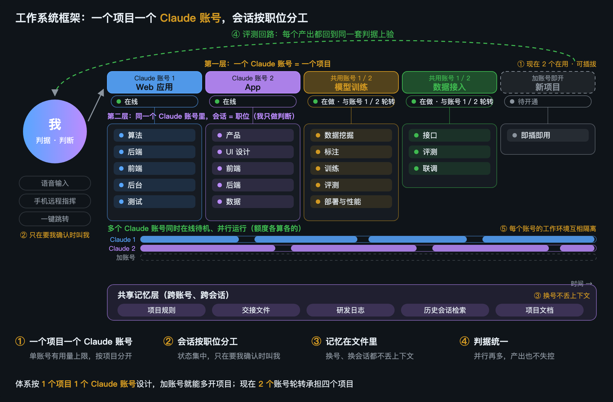

# 我给 Claude Code 写了一套 tmux 控制台：底栏、选择器、侧栏、一键换账号

> 发布前删掉这一段。图都在仓库 `docs/img/` 下：`demo.gif`、`framework.png`、`screen.png`、`statusbar.png`、
> `picker.png`、`sidebar.png`。全部是演示数据，界面是真代码画的（`docs/demo/shots.sh`、`gif.sh` 生成）。知乎题图用 `screen.png`。
>
> 2026-10-25：图换成了 `docs/img/` 下重新生成的版本；「红色告警」那段改成了现在的样子（9 月底就改了，
> 发知乎时这里没跟上）。知乎线上那篇还是旧说法，改不改见 `GUIDE.zh-CN.md`。


先说结论：这是一套跑在 tmux 里、管多个 Claude Code 会话的小工具，开源在
[github.com/threedaycat/claude-tmux-sessions](https://github.com/threedaycat/claude-tmux-sessions)。
它解决的是我自己天天碰到的三个问题：**不知道哪个会话在等我、不知道大家各在干什么、一个账号的额度用完了整条线就停了。**

## 我是怎么用 Claude Code 的

先交代背景，不然后面的设计看起来会有点奇怪。

我现在用两个 Claude 账号同时推几个项目，分工是这样的：



- **一个账号管一个项目。** 单个账号有 5 小时和 7 天两个用量窗口，一个项目跑得猛，别的项目会被一起卡住。按项目分账号，额度各算各的。
- **账号下的每个会话担一个职位。** 算法、后端、前端、测试各开一个，上下文只装自己那一摊事，不会越聊越杂。
- **我只做判断。** 不盯着某一个终端，只在有会话需要我拍板、或者做完了要我看结果的时候过去。
- **记忆写在文件里。** 项目规则、交接文件、研发日志，换号、换会话都接得上。

这么分以后，同时开着的会话就不少了，一个人盯不过来。tmux 本身只管窗口，不知道哪个窗口里的 Claude 在干什么。于是有了这套工具。

## 四块东西


### 底栏：谁在等你


每个会话的状态由 Claude Code 的 hooks 自己上报，底栏把它们数出来：

- `⏸` 在等你确认（权限框弹着，它在干等）——唯一会主动响铃、发系统通知的状态；
- `✔` 做完了，你还没看；
- `▶` 在跑，不用管；
- `✓` 做完了，你也看过了。

有会话卡在确认上时，`⏸` 的计数变红；窗口列表里每个窗口带自己的状态，在等你的那个窗口那一格也是红的。
点 `⏸` 直接跳到等得最久的那个会话。四个计数永远都在，数到 0 也只是变灰，位置不动，按记忆点不会点错。

右边是整机的 CPU、内存、交换、磁盘，开的会话多了，机器先撑不住，这个比你想象的有用。每一段都能点。

### 选择器：大家在干什么


`prefix + g`（或者点底栏左边）弹出所有会话，按 tmux session 也就是按项目分组；右边是光标所在会话的实时画面。
每行有编号，按数字直接跳过去。看过的自动变 `✓`，安静的那些默认收起来，列表只留要你处理的几个。

### 侧栏：这一个会话的一切


每个 Claude 右边贴一条侧栏，管的是「这一个会话」：

- **它说过的每一轮。** 你那一轮说了什么、它回复的开头。点一下，主界面直接滚到那一轮的最终回复。`/compact` 之前的轮次收成一行。
- **额度。** 上下文、5 小时、7 天三条，平时是灰的，快有问题了才变色。
- **一排按钮。** git（旁边是没提交的文件数）、文件、刷新额度、换账号、关闭。git 和文件弹窗浮在右边，点左边的 Claude 就关。

跟全局有关的放底栏，只跟当前会话有关的放侧栏——底栏地方有限，这条规矩让两边都不挤。

### 换账号：一个号用完了，接着干

点侧栏上的 ⇄，这个会话退出，再用另一个账号 `claude --resume` 同一个会话 id，对话接着聊，上下文不丢。
有几道安全闸：正在干活的不动，输入框里有你没发出去的字的不动（退出会丢）；窗口里开着队员（agent teams）的，
先往领队输入框里打一句让它收队，队员都退出了再换。

## 几个取舍

- **状态靠 hooks，不靠刮屏。** 会话自己在状态变化时上报，准，而且不轮询、不耗资源。只有「跳到第几轮」「输入框里有没有字」这种没有别的办法的地方才读屏幕。
- **是收件箱，不是仪表盘。** 看过的自动变 `✓`，会话一有新动作标记自动失效，列表不用人维护。
- **全程鼠标能用。** 我大部分时间是语音加触控板，所以每个按钮都能点，键盘快捷键也有。
- **换账号宁可不换，也不丢东西。** 拿不准的情况一律跳过，并告诉你原因。

## 拿来用

```bash
git clone https://github.com/threedaycat/claude-tmux-sessions.git ~/projects/claude-tmux-sessions
~/projects/claude-tmux-sessions/install.sh
```

然后在 tmux 配置里加一行 `source-file ~/projects/claude-tmux-sessions/tmux/claude-tmux.conf`，
再把底栏那几段拼进你的状态栏，README 里写得很清楚。

先说清楚几个限制：只在 macOS 上日常用过（Linux 没测）；界面是中文的；要装 Nerd Font；
有几处要读 Claude Code 的屏幕，它改版的时候可能要跟着改。有问题欢迎提 issue。
