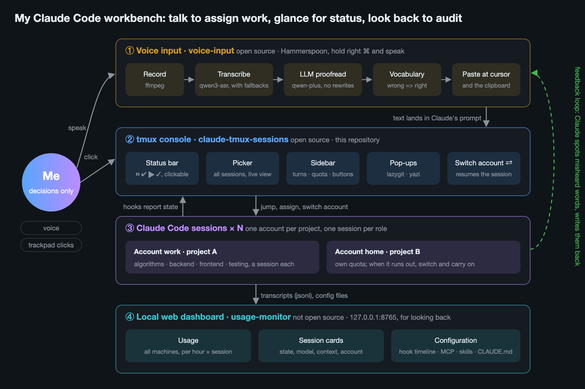
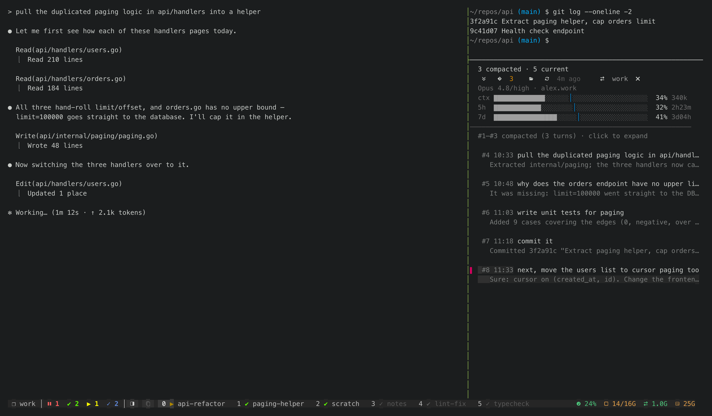
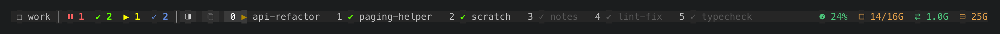
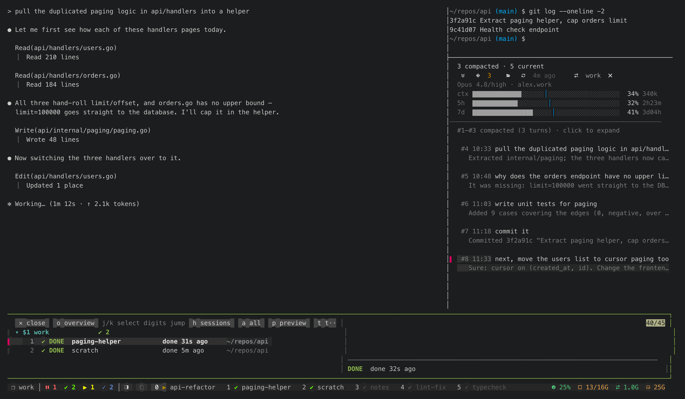
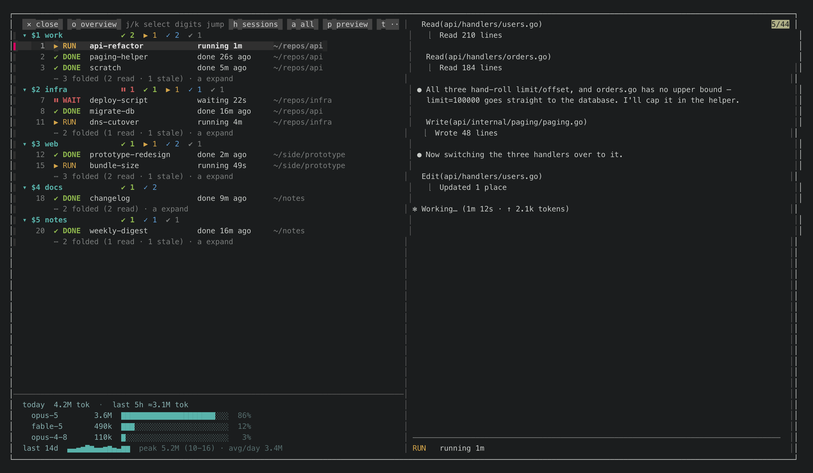
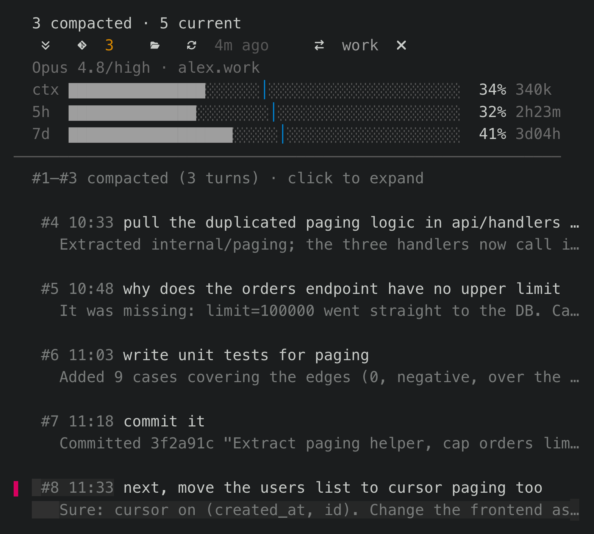
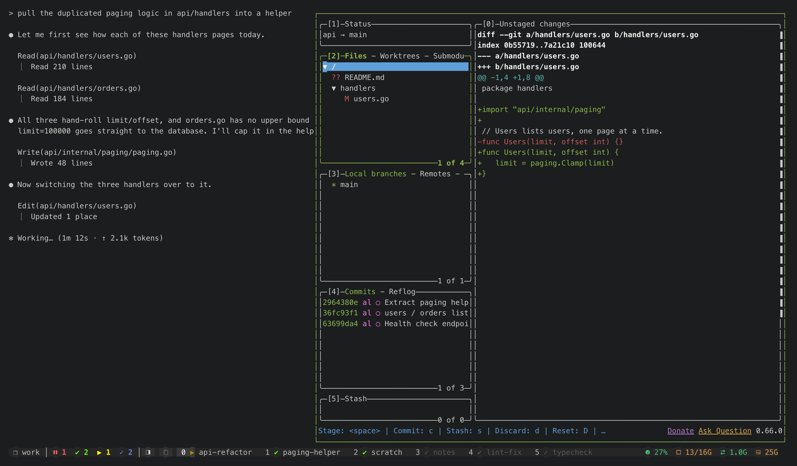
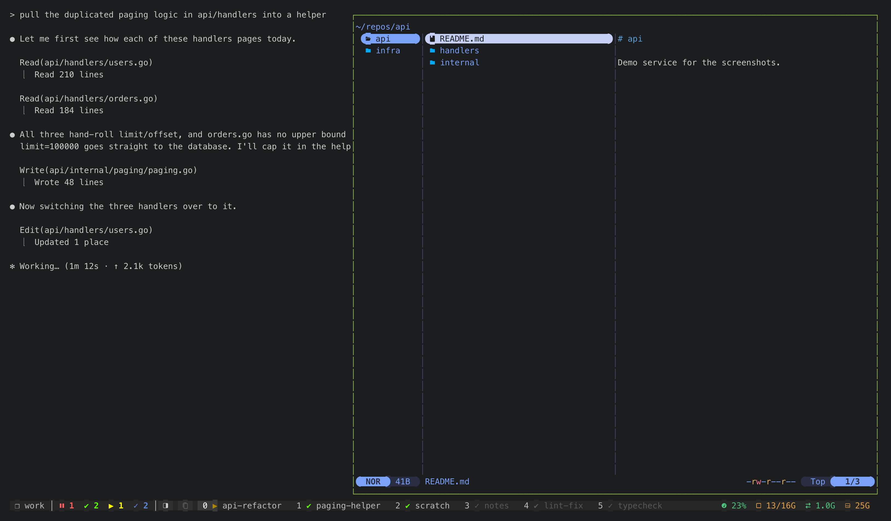
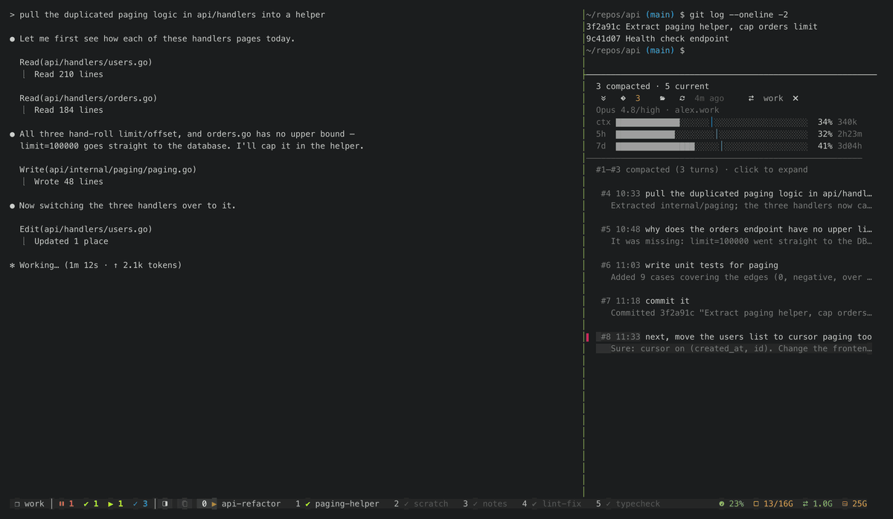

# My Claude Code workbench: talk to assign work, glance to see status, look back to audit

**English** · [简体中文](workbench.zh-CN.md)

I run a dozen or more Claude Code sessions at once. Four things make that workable:

1. **Voice input** turns what I say into text and drops it into Claude's prompt.
2. **The tmux console** tells me which session is waiting on me and takes me there in one click.
3. **Claude Code sessions** are split by project (one account each) and by role (one session each).
4. **A local web dashboard** is where I look back at usage, sessions and configuration.

This repository is number 2. Voice input is a separate open-source repository; the dashboard is not open source.
This page connects the four and, for each piece, covers **how you trigger it, how it works, and what it looks like**.



- [① Voice input: mixed Chinese and English, text in a second](#voice)
- [② The tmux console: who is waiting on you, and one click to get there](#tmux)
  - [Status bar: click a count to list those sessions](#bar)
  - [Picker: every session on one screen](#picker)
  - [Sidebar: everything about the session in front of you](#sidebar)
  - [git and file pop-ups: review changes without leaving Claude](#floats)
  - [Switch accounts: out of quota, keep the same conversation going](#switch)
- [③ Claude Code sessions: one account per project, one session per role](#sessions)
- [④ Web dashboard: looking back (not open source)](#web)
- [How the screenshots are made](#shots)

---

<a id="voice"></a>
## ① Voice input: mixed Chinese and English, text in a second

Repository: [threedaycat/voice-input](https://github.com/threedaycat/voice-input) (MIT, macOS + Hammerspoon).

**Trigger.** Hold the right Command key, speak, release: the text appears. Or tap once to start and tap again to stop.
The text is pasted at the cursor and also put on the clipboard. A small pill at the bottom of the screen shows the
recording time, the input level, and how many earlier clips are still being transcribed:

<p align="center"></p>

Almost everything I tell Claude, I say out loud. A few details exist just for Claude Code:

- Say only "compact" and you get `/compact`. Say only "继续" ("continue") and you get it without a full stop.
- Newlines are removed before pasting: Claude Code folds a multi-line paste into `[Pasted text]` and hides it.
- Mouse side buttons work too: hold the back button to talk, front button for Enter, middle button to paste.

**Three layers of correction.** English technical terms inside Chinese speech are what gets misheard most
("Claude Code" comes out as "Cloud Code").

| Layer | What it does | When it isn't enough |
|---|---|---|
| 1. Transcription hint | Your vocabulary list goes into the speech model's prompt: `qwen3-asr-flash`, falling back to Gemini, then a local model | New words that sound alike still come out wrong |
| 2. LLM proofreading | `qwen-plus` makes one pass under strict rules: drop fillers and stutters, fix punctuation, normalise English terms, **never rephrase** | If the output length changes a lot (it probably started answering), the proofread is thrown away and the raw transcript is used |
| 3. Replacement rules | `wrong => right`, applied in order; English matches whole words, case-insensitively | A rule that is too broad breaks normal speech elsewhere, so keep them narrow |

**Feedback loop: Claude maintains the vocabulary.** I don't write the layer-3 rules myself. My global `CLAUDE.md`
tells Claude: when you understood what I meant and can be sure of the intended word, add the misheard spelling to the
vocabulary and report it in one line at the end of your reply, e.g. `Noted: Archive 上 => arXiv 上`. The vocabulary lives in
my dotfiles, so every addition is a commit. Between 2026-09-26 and 10-25 that file got 91 commits and now holds
149 replacement rules and 63 terms.

The rule, ready to paste into your own `CLAUDE.md`:

```markdown
## Misheard words from voice input: add them to the vocabulary

When you understood what I meant and can be sure of the intended word, add it to
~/.config/voice-input/vocab.txt and say what you added in one line at the end of your reply
(`Noted: wrong => right`).
- The misheard spelling is stable → add `wrong => right`; if the right word is a rare proper noun,
  also add the word itself on its own line.
- Narrow beats broad: if the wrong spelling is an ordinary word, include the words around it,
  or normal speech elsewhere gets rewritten.
- Not sure → don't add it; ask "does X mean Y?" in your reply instead.
- Company, colleague and client names go into vocab.local.txt, which is never committed.
```

**Panel.** Menu bar microphone → Open panel: transcript history (replay, re-transcribe), counts and cost per day,
and calls per model. At list price it costs about ¥0.8 (≈ $0.11) per hour of audio.

<p align="center"></p>

---

<a id="tmux"></a>
## ② The tmux console: who is waiting on you, and one click to get there

This repository. Installation and every option are in the [README](../README.md); this section shows what each
part looks like and what happens when you click it.

The whole screen: Claude on the left, its sidebar on the right, the status bar at the bottom.



**Where the state comes from.** Claude Code hooks write each session's state to one JSON file
(`~/.claude/tmux-claude-status.json`) whenever it changes. The status bar, the picker and the window list all read
that file. Nothing polls and nothing scrapes the screen for it.

| Icon | State | Meaning |
|---|---|---|
| `⏸` | waiting | A permission prompt is open and Claude is idle until you answer. The only state that rings and sends a notification |
| `✔` | done, unread | Finished, and you haven't looked yet |
| `▶` | running | Nothing for you to do |
| `✓` | read | Finished, and you've seen it |

<a id="bar"></a>
### Status bar: click a count to list those sessions



The four counts are always there; a zero turns grey but keeps its place, so clicking from muscle memory never misses.
Each window in the window list carries its own state icon, and the cell of a window that is waiting on you turns red.
Every segment is clickable:

| Click | What happens | Behind it |
|---|---|---|
| Session name | A picker floats up from the bottom in session view: the cursor sits on the project, the preview shows a card per session | `float-picker.sh` |
| `⏸ 1` | Jumps straight to the session that has been waiting longest | `status-click.sh` → `jump-top.sh` |
| `✔ 2` / `▶ 1` / `✓ 2` | A picker with only that state; if there is exactly one such session it jumps there instead | `status-click.sh` → `float-picker.sh` |
| Sidebar button | Opens or closes the sidebar of the current Claude | `float-tool.sh` → `sidebar/trail-sidebar.sh` |
| CPU / memory / swap / disk | A small pop-up with details: what is using CPU and memory (Claude sessions are matched to their pane), which folders take the most disk | `float-tool.sh` → `sys-monitor.py` |
| Window name | Switches to that window | tmux itself |

Below: after clicking `✔ 2`, the two finished-but-unread sessions float up from the bottom, with a live view of the
highlighted one on the right; click a row to jump. The pop-up is a tmux 3.7 floating pane, not `display-popup`, so
clicking anywhere outside closes it (`display-popup` swallows clicks outside its box).



<a id="picker"></a>
### Picker: every session on one screen

`prefix + g`, or click the session name. Sessions are grouped by tmux session, i.e. by project; every row has a
number, and typing it jumps there. The right side is a live view of the session under the cursor. Quiet sessions
(read, or unread for hours) are folded away by default, so the list shows only what needs you. At the bottom:
today's tokens per model and a 14-day sparkline.



The grey words along the top are buttons: an overview of every project, a session view of what each one is doing,
a token view of who uses the most quota, expand all, and hide the preview.

<a id="sidebar"></a>
### Sidebar: everything about the session in front of you

When the window is wide enough (≥ 120 columns), switching to a Claude opens a sidebar on its right. It reads the
transcript Claude Code writes itself (`~/.claude/projects/*/*.jsonl`), not the screen:

- **One entry per turn**: what you said and the start of the reply. Click one and the main pane scrolls to that
  turn's final answer. Turns before a `/compact` fold into one line.
- **Three quota bars**: context, 5-hour, 7-day. Grey until one runs well ahead of an even pace, then orange, then red.
- **A row of buttons**: ⇊ jump to bottom, git (the number is uncommitted files), files, ⟳ refresh quota,
  ⇄ switch account, ✕ close.
- **Above the sidebar**, a shell in the same directory as this Claude, for quick commands.

<p align="center"></p>

<a id="floats"></a>
### git and file pop-ups: review changes without leaving Claude

The git and files buttons on the sidebar open a tool in this Claude's directory, **floating on the right at 60 % of
the width**; the Claude on the left keeps its size and doesn't re-wrap. Click outside to close it, click the same
button again to close it, click the other button to swap. The width lives in `~/.local/state/float-tool-width`.

**git is [lazygit](https://github.com/jesseduffield/lazygit).** See which files Claude changed, read the diff, commit,
switch branches, all with the mouse. If the directory isn't a repository (say `~/work`, with many repositories
under it), the pop-up first lists the repositories up to three levels down, most recently touched first; click one.



**Files is [yazi](https://github.com/sxyazi/yazi).** Click to select, scroll to page, a live preview on the right.
The pop-up is for looking, not editing: clicking outside closes it, and an editor inside would lose unsaved work.
So "open" on a text file goes to `float-tool.sh --edit`, which opens `$EDITOR` in a new tmux window in the same
session and closes the pop-up.



For that "open" behaviour, add this to `~/.config/yazi/yazi.toml`:

```toml
[opener]
edit = [
  { run = '~/.claude/hooks/float-tool.sh --edit %s', desc = "Editor (new tmux window)", orphan = true, for = "unix" },
]
```

<a id="switch"></a>
### Switch accounts: out of quota, keep the same conversation going

Click ⇄ on the sidebar: the session exits and comes back as `claude --resume` of the same session id under the other
account, conversation and context intact. When in doubt it does nothing and tells you why: a session that is working
is left alone; one with unsent text in the prompt is left alone (exiting would lose it); a window with teammates
(agent teams) first gets a line typed to the lead asking it to wind the team down, and switches once they have exited.



---

<a id="sessions"></a>
## ③ Claude Code sessions: one account per project, one session per role

This is a way of working, not a tool, but everything above is built for it:

- **One account per project.** Each account has a 5-hour and a 7-day usage window. If one busy project shares an
  account with the others, it stalls them too. With an account per project, each has its own quota. Accounts are kept
  apart with `CLAUDE_CONFIG_DIR` and listed in `~/.config/claude-tmux/accounts.json`.
- **One session per role inside an account.** Algorithms, backend, frontend, testing: one session each, so each
  context holds only its own part of the work.
- **I only make decisions.** I don't watch any one terminal; I go over when `⏸` or `✔` lights up.
- **Memory lives in files.** Project rules (`CLAUDE.md`), hand-off notes and a dev log are in the repository, so
  switching accounts or sessions loses nothing.

---

<a id="web"></a>
## ④ Web dashboard: looking back (not open source)

A local web page (`127.0.0.1:8765`, served by Python's standard library, kept running by launchd). It lives in the same
private repository as my cloud billing and VPN traffic pages, so it isn't open source. Only the three Claude tabs are
described here. The screenshots use invented data (two machines, `mac-studio` / `macbook-air`; two accounts,
`alex.work` / `alex.home`), and the dashboard's UI is Chinese only.

**Usage.** Claude Code's own `/usage` only says "5-hour window: x %, this week: y %". This page counts the tokens of
every request in the transcripts (deduplicated by message id; input, cache writes, cache reads and output kept
apart) and sums them per hour × session. Several computers fetch each other's numbers directly over Tailscale, so you
see them together. It also estimates how many tokens one official percentage point is worth.


**Sessions.** One block per tmux session on each machine, one card per Claude pane: state (waiting / working / idle),
model and effort, context used, account, length of the last turn. A small grid at the top lays them out by
account × model, so you can see at a glance how many run on which account. Cards act on panes of this machine:
pick an option in a permission prompt, send a line, interrupt (Esc), switch account. Those requests are accepted only
from the page itself (the Origin must be local), and only for a pane that was just seen still running Claude.


**Configuration.** Before this page, answering "which hooks do I have, when do they fire, what do they run" meant
opening `~/.claude/settings.json`, each project's `.claude/settings*.json`, `~/.claude.json`, `.mcp.json` files and
`~/.claude/skills/` one by one. This page reads them all:

- **Execution order**: one turn as a timeline, with every hook placed where it actually fires.
- **MCP servers, skills, permissions**: each with the file it comes from and who wrote it (me / third party /
  Anthropic), judged from the real path after resolving symlinks and from the remote of the repository it is in.
- **CLAUDE.md**: every CLAUDE.md on the machine, ranked by estimated tokens. The whole file enters the context of
  every session, so large ones are highlighted.


---

<a id="shots"></a>
## How the screenshots are made

The tmux screenshots and the GIF are drawn by the real code on invented data — not edited by hand, not taken from my
own machine. `docs/demo/stage-demo.sh` starts a private tmux server with a fake `$HOME`; `docs/demo/shots.sh`
calls the real scripts the way a mouse click would, then captures the screen and renders it to PNG. Change the
code, run it again, and the images are current:

```bash
CLAUDE_TMUX_LANG=en docs/demo/shots.sh docs/img/en     # → docs/img/en/*.png
CLAUDE_TMUX_LANG=en docs/demo/gif.sh docs/img/en/demo.gif
```

Details in [docs/demo/README.md](demo/README.md) (Chinese). The voice input images come from its own repository;
the dashboard images come from a demo script in that private repository.
