# 我的 Claude Code 工作台：说话派活，看状态，回头对账

[English](workbench.md) · **简体中文**

一个人同时带十几个 Claude Code 会话，靠四样东西：

1. **语音输入**：把说的话变成文字，送进 Claude 的输入框。
2. **tmux 控制台**：告诉你哪个会话在等你，一下跳过去。
3. **Claude Code 会话**：按项目分账号、按职位分会话，各干各的。
4. **本机 Web 面板**：回头看用量、会话和配置。

本仓库是第 2 样。语音输入是另一个开源仓库，Web 面板没有开源。这一页把四样东西串起来讲，
每块讲清三件事：**怎么触发、背后怎么工作、长什么样**。

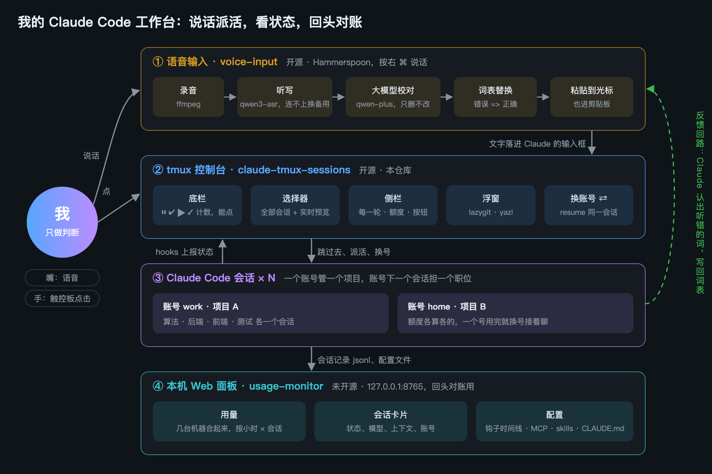

- [① 语音输入：中英夹杂，一秒出字](#voice)
- [② tmux 控制台：谁在等你，一下跳过去](#tmux)
  - [底栏：点一下就弹出那一类会话](#bar)
  - [选择器：所有会话一屏看完](#picker)
  - [侧栏：只管眼前这一个会话](#sidebar)
  - [git 和文件浮窗：不离开 Claude 看改动](#floats)
  - [换账号：额度用完，接着原会话聊](#switch)
- [③ Claude Code 会话：一个账号一个项目，一个会话一个职位](#sessions)
- [④ Web 面板：回头对账（未开源）](#web)
- [截图怎么来的](#shots)

---

<a id="voice"></a>
## ① 语音输入：中英夹杂，一秒出字

仓库：[threedaycat/voice-input](https://github.com/threedaycat/voice-input)（MIT，macOS + Hammerspoon）。

**怎么触发。** 按住右 Command 说话，松开就出字；或者轻点一下开始、再点一下结束。文字粘贴到光标处，
同时放进剪贴板。屏幕底部有一个小浮窗，显示录音时长、音量和后台还有几段在转写：

<p align="center"></p>

我几乎所有给 Claude 的话都是说出来的。它对 Claude Code 做了几处专门的处理：

- 整段只说 "compact"，输出 `/compact`；只说「继续」，输出「继续」，不带句号。
- 粘贴前去掉换行：Claude Code 会把多行粘贴折叠成 `[Pasted text]`，看不到内容。
- 鼠标侧键也能用：后侧键按住说话、前侧键回车、中键粘贴，手不用离开触控板和鼠标。

**纠错分三层。** 中文里夹的英文技术词最容易听错（"Claude Code" 常被写成 "Cloud Code"）。

| 层 | 做什么 | 管不住时 |
|---|---|---|
| 1. 听写提示 | 把常用词表写进听写模型的提示：`qwen3-asr-flash`，连不上换 Gemini，再不行用本机模型 | 发音相近的生词还是会错 |
| 2. 大模型校对 | `qwen-plus` 按严格规则过一遍：只删「嗯啊」和重复、改标点、把英文词改成标准写法，**不许改写原话** | 输出长度明显变了（多半在回答问题），丢掉校对结果，用原始听写 |
| 3. 词表规则 | `错误 => 正确` 逐条替换，英文按整词、不分大小写 | 规则写宽了会误伤，所以要「宁窄勿宽」 |

**反馈回路：Claude 帮我维护词表。** 第 3 层的规则不是我自己记的。我在全局 `CLAUDE.md` 里给 Claude
定了一条规矩：读懂了我的意思、又能确定原词时，就把听错的写法加进词表，回复末尾报一行
`已记：Archive 上 => arXiv 上`。词表在 dotfiles 里，每次加词都是一个 commit。
2026-09-26 到 10-25，词表有 91 次提交，攒下 149 条替换规则、63 个常用词。

规则的要点，可以照抄进你自己的 `CLAUDE.md`：

```markdown
## 语音输入听错的词：看出来就记进词表

你读懂了意思、并且能确定原词时，顺手加进 ~/.config/voice-input/vocab.txt，
回复末尾用一行说加了什么（`已记：错误 => 正确`）。
- 听错的写法是固定的 → 加 `错误 => 正确`；正确的词是生僻专名 → 同时加一行词本身。
- 宁窄勿宽：错误写法是常用词就带上前后文，否则别处的正常话会被改坏。
- 猜不准就不加，在回复里问一句「X 是不是指 Y」。
- 公司名、同事名这类只该留在本机的词，记进 vocab.local.txt（不进共享的仓库）。
```

**面板。** 菜单栏麦克风 → 打开面板：转写记录（能重听、重新转写）、每天的次数和花费、各模型的调用情况。
按标价约 ¥0.8 / 小时录音。

<p align="center"></p>

---

<a id="tmux"></a>
## ② tmux 控制台：谁在等你，一下跳过去

就是本仓库。安装和全部配置见 [README](../README.zh-CN.md)，这里只讲每块长什么样、点了会发生什么。

整屏是这样：左边是 Claude，右边是它的侧栏，最下面是底栏。

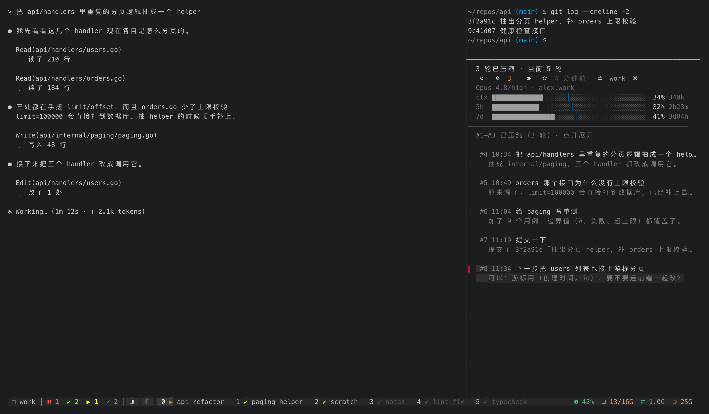

**状态从哪来。** 每个会话的状态由 Claude Code 的 hooks 在状态变化时写进一个 JSON 文件
（`~/.claude/tmux-claude-status.json`）。底栏、选择器、窗口列表都读这个文件，不轮询、不刮屏。

| 图标 | 状态 | 意思 |
|---|---|---|
| `⏸` | 等确认 | 权限框弹着，Claude 在干等你。唯一会响铃、发系统通知的状态 |
| `✔` | 做完没看 | 跑完了，你还没看 |
| `▶` | 在跑 | 不用管 |
| `✓` | 看过了 | 跑完了，你也看过了 |

<a id="bar"></a>
### 底栏：点一下就弹出那一类会话

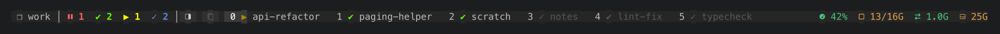

四个计数永远都在，数到 0 也只是变灰，位置不动，按记忆点不会点错。窗口列表里每个窗口带自己的状态图标，
在等你的那个窗口那一格是红的。底栏每一段都能点：

| 点哪儿 | 发生什么 | 背后 |
|---|---|---|
| session 名 | 底部浮出选择器，按项目看：光标停在项目那一层，右边是这个项目每个会话的卡片 | `float-picker.sh` |
| `⏸ 1` | 直接跳到等得最久的那个会话 | `status-click.sh` → `jump-top.sh` |
| `✔ 2` / `▶ 1` / `✓ 2` | 只列这一类的选择器；这一类只有一个时不弹框，直接跳过去 | `status-click.sh` → `float-picker.sh` |
| 侧栏按钮 | 开 / 关当前 Claude 的侧栏 | `float-tool.sh` → `sidebar/trail-sidebar.sh` |
| 右边 CPU / 内存 / 交换 / 磁盘 | 右下角浮出那一项的明细：谁在吃 CPU、谁在吃内存（Claude 会话认得出是哪个窗格）、哪些目录最占磁盘 | `float-tool.sh` → `sys-monitor.py` |
| 窗口名 | 切到那个窗口 | tmux 自己的 |

下图是点了 `✔ 2`：底部浮出两个做完没看的会话，右边是光标所在那个的实时画面，点一行就跳过去。
浮窗是 tmux 3.7 的浮动 pane，不是 `display-popup`：所以点浮窗外面任何地方都会关掉它
（`display-popup` 会吞掉框外的点击）。

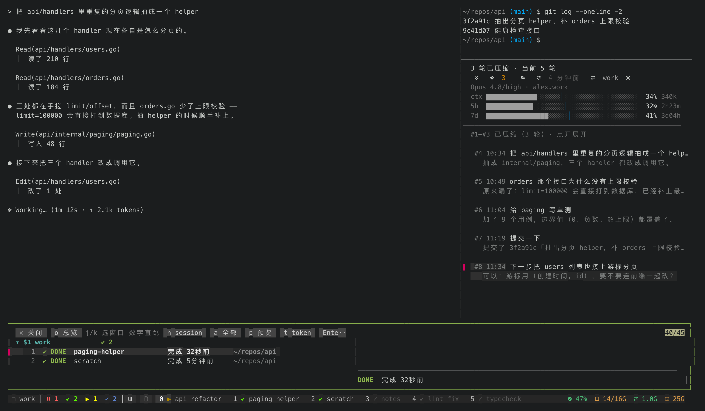

<a id="picker"></a>
### 选择器：所有会话一屏看完

`prefix + g`（或点底栏的 session 名）。按 tmux session 也就是按项目分组，每行有编号，按数字直接跳；
右边是光标所在会话的实时画面。安静的会话（看过的、放了几小时没看的）默认收起，列表只留要你处理的。
底部是今天各模型的 token 用量和近 14 天的曲线。

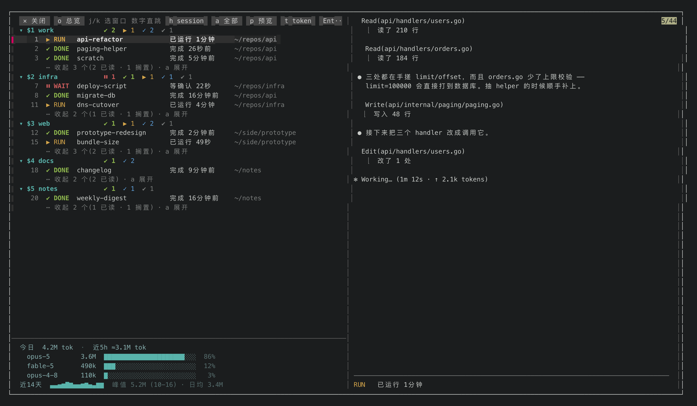

顶上一排灰底的词都是按钮：`总览` 一屏看各项目的局面，`session` 看每个会话在干什么，
`token` 看谁最费额度，`全部` 展开收起的会话，`预览` 收起右边的画面。

<a id="sidebar"></a>
### 侧栏：只管眼前这一个会话

窗口够宽（≥120 列）时，切到一个 Claude 就自动在它右边开侧栏。侧栏读 Claude Code 自己写的会话记录
（`~/.claude/projects/*/*.jsonl`），不读屏幕：

- **每一轮一项**：你那一轮说了什么、它回复的开头。点一下，主界面滚到那一轮的最终回复。
  `/compact` 之前的轮次收成一行。
- **额度三条**：上下文、5 小时、7 天。平时灰色，超出匀速线太多才变橙、变红。
- **一排按钮**：⇊ 到最底、git（后面的数字是没提交的文件数）、文件、⟳ 刷新额度、⇄ 换账号、✕ 关闭。
- **侧栏上方**是这个 Claude 所在目录的一个 shell，随手敲命令。

<p align="center">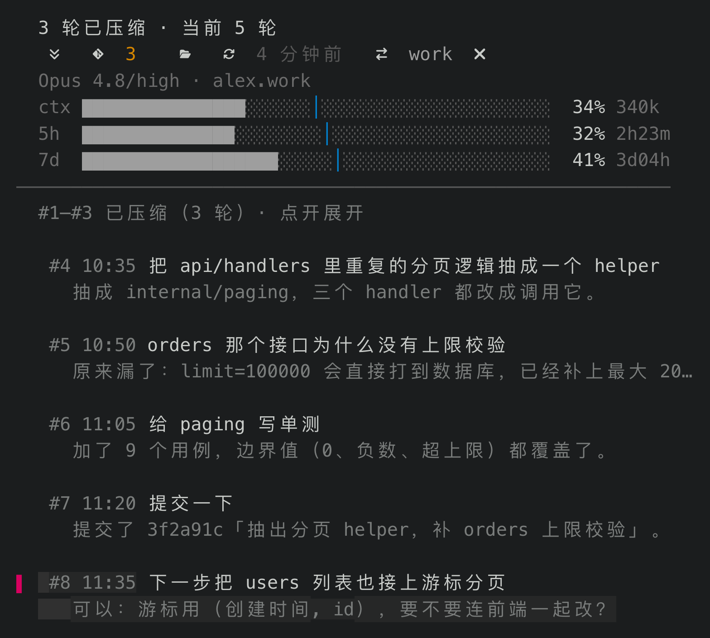</p>

<a id="floats"></a>
### git 和文件浮窗：不离开 Claude 看改动

点侧栏上的 git 或文件按钮，在这个 Claude 的目录里浮出一个工具，**贴右边、占 60% 宽**，左边的 Claude
不动、不重新换行。点浮窗外面就关；再点同一个按钮也关；点另一个按钮就换过去。宽度存在
`~/.local/state/float-tool-width`，改数字就行。

**git 用 [lazygit](https://github.com/jesseduffield/lazygit)。** 看 Claude 改了哪些文件、逐行 diff、
提交、切分支，全程能用鼠标。当前目录不是仓库时（比如 `~/work`，下面一堆仓库），先在浮窗里列出下面三层的仓库，
最近动过的在上面，点一个打开。

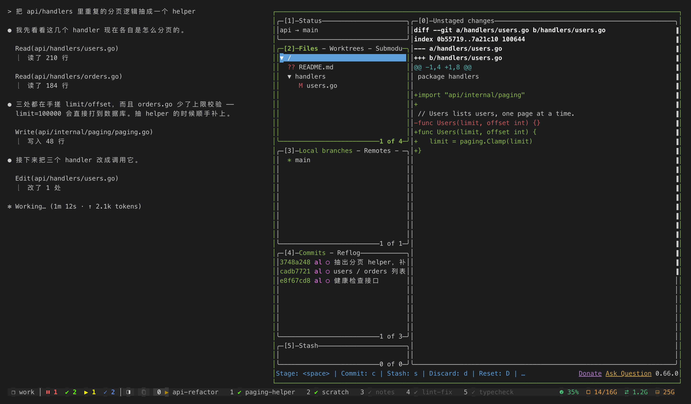

**文件用 [yazi](https://github.com/sxyazi/yazi)。** 单击选中、滚轮翻页、右边直接预览内容。浮窗里只看不改：
点外面浮窗就关，在里面开编辑器会连同没存的改动一起丢。所以「打开」一个文本文件时，交给
`float-tool.sh --edit`，在同一个 session 新开一个 tmux 窗口跑 `$EDITOR`，浮窗随即关掉。

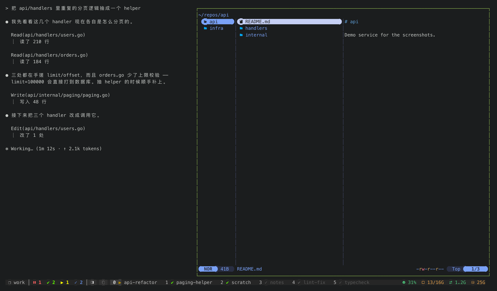

要这个「打开」行为，在 `~/.config/yazi/yazi.toml` 里加：

```toml
[opener]
edit = [
  { run = '~/.claude/hooks/float-tool.sh --edit %s', desc = "编辑器（新 tmux 窗口）", orphan = true, for = "unix" },
]
```

<a id="switch"></a>
### 换账号：额度用完，接着原会话聊

点侧栏上的 ⇄：这个会话退出，再用另一个账号 `claude --resume` 同一个会话 id，对话和上下文都在。
拿不准的一律不动，并告诉你原因：正在干活的不动；输入框里有没发出去的字的不动（退出会丢）；
窗口里开着队员（agent teams）的，先往领队输入框里打一句让它收队，队员都退出了再换。

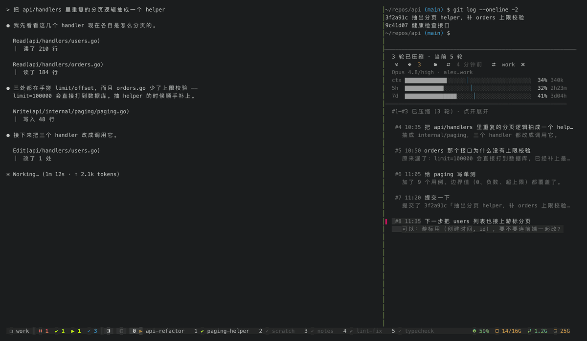

---

<a id="sessions"></a>
## ③ Claude Code 会话：一个账号一个项目，一个会话一个职位

这是用法，不是工具，但前面所有设计都是为它服务的：

- **一个账号管一个项目。** 单个账号有 5 小时和 7 天两个用量窗口。一个项目跑得猛，别的项目会被一起卡住。
  按项目分账号，额度各算各的。账号之间靠 `CLAUDE_CONFIG_DIR` 分开，列在 `~/.config/claude-tmux/accounts.json`。
- **账号下的每个会话担一个职位。** 算法、后端、前端、测试各开一个，上下文只装自己那一摊事。
- **我只做判断。** 不盯着某一个终端，只在 `⏸` 或 `✔` 亮了的时候过去。
- **记忆写在文件里。** 项目规则（`CLAUDE.md`）、交接文件、研发日志都进仓库。换号、换会话都接得上。

---

<a id="web"></a>
## ④ Web 面板：回头对账（未开源）

一个本机网页（`127.0.0.1:8765`，Python 标准库起的服务，launchd 常驻）。它跟阿里云账单、VPN 流量放在
同一个私有仓库里，所以没有开源。这里只介绍跟 Claude 有关的三个分页，截图用的是演示数据（两台机器
`mac-studio` / `macbook-air`、两个账号 `alex.work` / `alex.home`）。

**用量页。** Claude Code 自己的 `/usage` 只给「5 小时、本周用了百分之几」。这一页从会话记录里数每次请求的
token（按 message id 去重，输入、写缓存、读缓存、输出分开记），按「小时 × 会话」汇总；几台电脑通过
Tailscale 直连互相取数，合在一起看。还能算出「官方 1% 大约等于多少 token」。

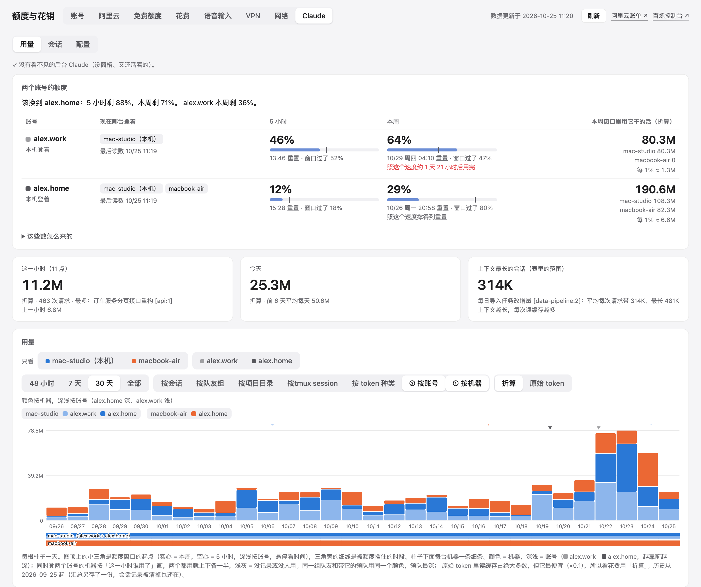

**会话页。** 每台机器上每个 tmux session 一块，每个 Claude 窗格一张卡片：状态（等你确认 / 工作中 / 空闲）、
模型和推理强度、上下文用量、账号、上轮用时。最上面一张小格子图按「账号 × 模型」摆，一眼看出哪个号上跑着几个。
卡片上能直接操作本机的窗格：在权限确认里点选项、发一句话、中断（Esc）、切账号。这些请求只认本页自己发的
（Origin 必须是本机），窗格号必须是刚采到、还在跑 Claude 的。

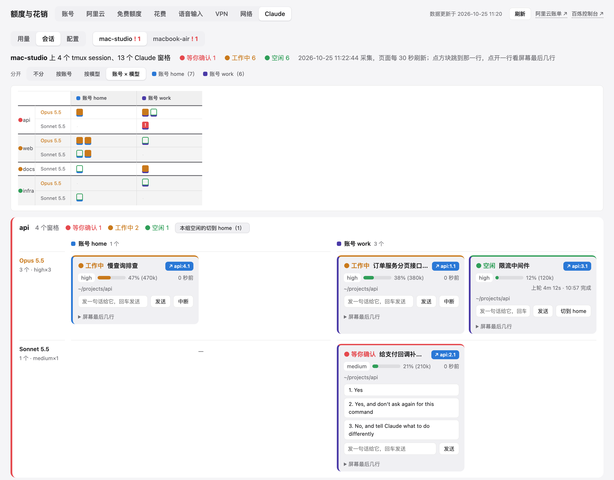

**配置页。** 以前想知道「现在有哪些 hooks、什么时候触发、跑的哪个脚本」，要一个个翻
`~/.claude/settings.json`、各项目的 `.claude/settings*.json`、`~/.claude.json`、`.mcp.json` 和
`~/.claude/skills/`。这一页把它们读到一起：

- **执行顺序**：一轮对话的时间线，每个 hook 放在它真正被触发的位置。
- **MCP、skills、权限**：每条标出来源文件，和「谁写的」（我自己 / 第三方 / Claude 官方），
  判据是软链解开后的真实路径和所在仓库的 remote。
- **CLAUDE.md**：本机所有 CLAUDE.md 按估算 token 排。它每次开会话都整篇进上下文，太大的标黄。

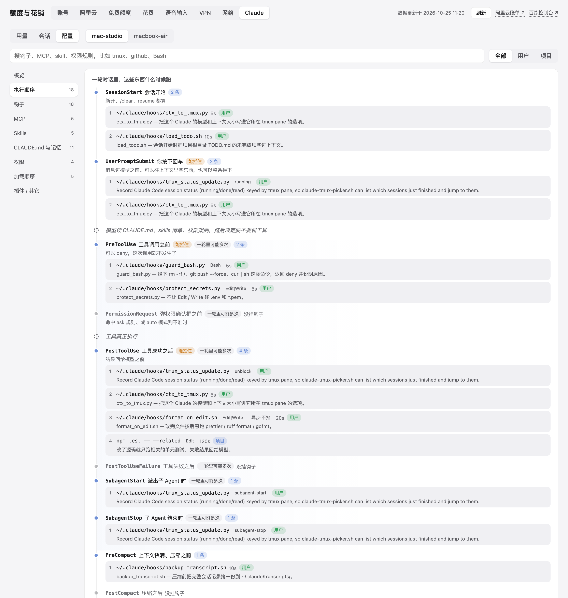

---

<a id="shots"></a>
## 截图怎么来的

tmux 部分的截图和 GIF 都是真代码在演示数据上画的，不是手工修的图，也不是拿我的真机截的：
`docs/demo/stage-demo.sh` 起一个私有 tmux server 和一个假的 `$HOME`，`docs/demo/shots.sh` 像鼠标点击一样
调真实的脚本，再把屏幕抓下来渲染成 PNG。代码一改，重跑一遍就是新图：

```bash
docs/demo/shots.sh     # → docs/img/*.png
docs/demo/gif.sh       # → docs/img/demo.gif
```

细节见 [docs/demo/README.md](demo/README.md)。语音输入的图来自它自己的仓库；Web 面板的图由那个私有仓库里的
演示脚本生成。
