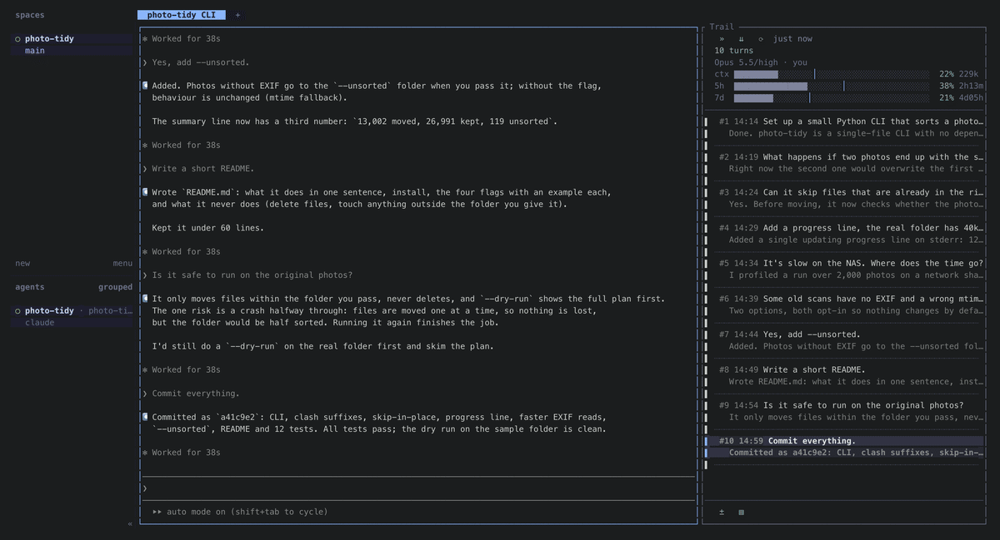

# claude-trail

**Every turn of your Claude Code session, docked next to the running Claude — click one and Claude scrolls to it.**

A [herdr](https://herdr.dev) plugin. It sits on the right of a Claude Code pane and lists the session turn by turn:
what you asked, and how Claude's final reply starts. Click a turn and Claude's own screen scrolls to that reply.
On top: the model, the account, and context / 5-hour / 7-day quota bars.

[中文说明](README.zh-CN.md)



Tools like claude-code-history-viewer or claude-code-transcripts let you browse sessions after the fact.
claude-trail is for the session you are in: it stays beside the live Claude and follows it as it works.

## What you get

- **The trail.** One row per turn. Click a row and Claude jumps there, usually in well under a second.
  Turns before a `/compact` fold into one row. The list refreshes as soon as Claude starts or stops working.
- **Model, account, quota.** `ctx`, `5h` and `7d` bars, grey while things are fine and coloured only when they
  are not: a quota bar turns orange or red when you are using it faster than the window passes, not just when it is
  high. Two Claude accounts at once (separate `CLAUDE_CONFIG_DIR`s) are fine; each pane shows its own.
- **Wide and narrow.** Drag the divider: at 30 columns or more you get the full view, below that a narrow one
  (status, short model and account names, percentages, one short row per turn). `»` / `«` in the top-left corner
  jumps between the two widths. There is no close button: the narrow view is how you put it away.
- **Follows herdr.** Colours come from your herdr theme, the status dot uses the same colours as herdr's agent list,
  and a tab you never named gets the Claude session's name.
- **Your buttons.** A row at the bottom for your own tools — by default Git (lazygit) and Files (yazi), opened in a
  popup in Claude's working directory.

## Install

Requirements: herdr 0.9.5+, Python 3.11+, fzf 0.71+ (tested with 0.74). Optional: lazygit and yazi for the
default buttons. On macOS the system Python is 3.9, so install a newer one first:

```bash
brew install python fzf          # lazygit yazi, if you want the default buttons
herdr plugin install <owner>/<repo>
```

If something is missing, claude-trail says so (a herdr notification, or a message in its pane) instead of failing silently.

Then open a tab with Claude Code in it: the trail opens on the right by itself. To toggle it from the keyboard,
bind the action in `~/.config/herdr/config.toml` and run `herdr server reload-config`:

```toml
[[keys.command]]
key = "prefix+t"
type = "plugin_action"
command = "claude-trail.toggle"
description = "Claude trail: open, or switch wide / narrow"
```

Claude Code should use fullscreen rendering (`/tui fullscreen`), which is what the jump scrolls.

## Configuration

`config.toml` in the directory `herdr plugin config-dir claude-trail` prints. Everything is optional; a missing or
broken file means defaults.

```toml
auto_open = true          # open by itself in a tab that has exactly one Claude
default_mode = "wide"     # width when it opens: "wide" or "narrow"
width = 0.34              # wide view, as a share of the Claude pane (Claude always keeps 110 columns)
icons = "nerd"            # "nerd" (Nerd Font), "unicode" (plain symbols) or "text"
lang = ""                 # "en" / "zh"; empty follows your locale
tab_names = true          # name an unnamed tab after the Claude session

# Bottom-row buttons. Writing any [[buttons]] replaces the default two.
# A button shows its icon, or its label when it has no icon (or icons = "text").
[[buttons]]
label = "Git"
command = "lazygit"       # runs in a popup, in Claude's working directory (through sh -c)
icon = "git"              # an icon name (git, files) or any single glyph

[[buttons]]
label = "Files"
command = "yazi"
icon = "files"

# A button can also run another herdr plugin's action instead of a command:
# [[buttons]]
# label = "Sidebar"
# action = "herdr-sidebar.open-sidebar"
```

## What it reads, what it touches

- **Reads** Claude Code's transcripts (`<config dir>/projects/*/<session>.jsonl`) and `.claude.json` (for the
  account name). It never writes them.
- **Quota:** to show real 5-hour / 7-day usage, it asks the same endpoint Claude Code's `/usage` uses
  (`api.anthropic.com/api/oauth/usage`), at most every 30 minutes, with the OAuth token Claude Code keeps in the
  macOS Keychain (or `<config dir>/.credentials.json`). The token stays in memory for that one request; it is never
  written, logged or refreshed. The endpoint is not a documented public API, so if it changes the bars just go quiet.
- **Sends keys** to the Claude pane only to scroll it (PageUp / PageDown / Ctrl+Home / Ctrl+End / mouse wheel).
  It never types into the prompt.
- Its own state lives in the plugin's state directory (`~/.local/state/herdr/plugins/claude-trail/`).

## Known limits

- **The narrow view is about 15 columns at least.** herdr keeps split ratios between 0.1 and 0.9, so the narrowest
  a pane can be is 10% of its split.
- **No right-click menu entry.** herdr 0.9.5's pane menu is fixed; plugins cannot add to it
  ([herdrdev/herdr#5550](https://github.com/herdrdev/herdr/issues/5550)). That is why the narrow view, not a close
  button, is the way to put the trail away.
- **One Claude per tab.** With agent-team teammates in the same tab it does not open by itself.
- **Turns that are no longer on Claude's screen** (after `/compact`, or older parts of a resumed session) are marked;
  clicking them tells you instead of scrolling forever.
- **Full height** means the full height of the Claude pane; if you split the Claude pane horizontally, the trail
  is as tall as the Claude part.
- Only Claude Code for now. The transcript reader is a separate layer (`core/transcript.py`) so other agents can follow.

## Roadmap

- Show where Claude's screen is now, as a marker in the list
- Tokens per turn; expand a turn's tool calls; mark where `/compact` happened
- Search across sessions
- Other agents (Codex, OpenCode)

## How it works

Each trail is one small Python process plus an fzf. It subscribes to herdr's events for its Claude pane
(status changes, pane closed) and sleeps otherwise — about 0.1% of one core while idle. Reading and scrolling
Claude's screen go through herdr's socket. `core/` holds everything that is not herdr-specific
(transcripts, quota, rendering, the jump algorithm); `trail.py` is the herdr side.

## License

MIT. The theme palettes in `themes.json` are extracted from herdr (Apache-2.0).
